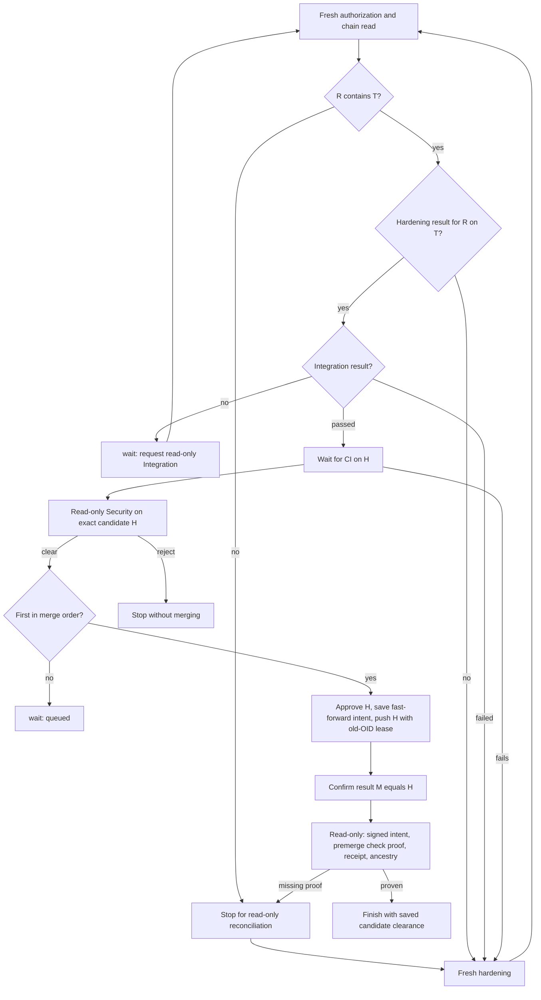

# Merge

This page describes the `merge` stage: what it may merge, merge order, the merge call, confirming the result, and completion. Synchronization with the base is the separate Sync task in [sync](sync.md). The rules are in [delivery decisions](../decisions/delivery.md) and [buddies and tasks](../decisions/buddies-and-tasks.md).

## What may merge

The merge stage merges only the revision its authorization names: the exact hardened, checked and Security-cleared code/input revision. It reads that authorization fresh before every mutation.

- A trusted-input change sends authored work back to Author and direct work back to Developer. Direct work needs no Gherkin or substitute requirements document.
- Any changed code head goes back to `review` for hardening.
- A base that moved or a conflict needs the Sync task: the merge stage never synchronizes itself (see [sync](sync.md)).
- A failed check, in Integration or CI, goes back to `review`, where Hardening fixes it as a new revision. The merge stage never runs a writer.

The merge stage reads the chain fresh with the read-only `task-readiness` op before it acts. It needs a passed Hardening and a passed Integration [task result](task-results.md) for exactly the current revision R and target T. A saved `hardened` checkpoint or `verifiedSha` from before #186 isn't a result: without the records, the work returns to review for fresh Hardening.



## Merge order

Merge order keeps slow issues from losing races repeatedly.

- With `--merge-queue N1,N2,…`, an issue ranked ahead that is at `review` or `merge` holds the slot, whatever its verdict.
- Without a queue, the merge stage applies no order. The `merge` op also accepts `mergeOrder: true`, under which an older PR at the `merge` stage whose lease hasn't expired holds the slot; the merge stage doesn't set it today.
- A held issue gets `{"merged": false, "reason": "queued", "waitingFor": N, "waitingForPr": PR}` and the job ends with `wait`.

The queue orders configured target mutations, not candidate-local integration, checks or read-only Security. It is not permission to run merges concurrently. Each exact Land also takes the [target's integration turn](#the-targets-integration-turn), so two Lands never write one target at once; the queue still decides who goes first.

## The merge call

1. Security clears the exact hardened and checked candidate at the observed target revision. A rejection, stale or missing clearance prevents approval and merge. The review/merge account submits a GitHub `APPROVE` review of the exact head H. A failed or mismatched approval prevents the merge.
2. A merge-authored, editor-verified `mergeAttempt` checkpoint is saved and reread. It binds the repository, PR, literal base, source branch, original authorization, hardening and integration, plus `operation: {kind: "fast-forward", base: P}` for the observed old target P. From then on, no automatic code write or repeat target mutation is allowed, even if the push is never sent.
3. The job requires P to be a strict ancestor of H, then pushes the full immutable SHA H to the configured repository's literal `refs/heads/<baseBranch>` with an explicit old-OID lease (`--force-with-lease=refs/heads/<baseBranch>:P`). The lease compares the remote old object ID; it does not authorize replacing non-ancestor work. The PR's own target and branch never choose the write. There is no REST merge, fallback PR merge, alternate push or admin bypass.
4. An acknowledged push saves and rereads H as response evidence, not a confirmed own receipt. The new result is M = H, not a new two-parent commit. A failed, lost or malformed response never authorizes a repeat mutation.

The base may differ from the repository's default branch. Merging to a configured base isn't permission to deploy anywhere.

## Confirm the result

Read-only fast-forward reconciliation requires the bound signed intent, strict P-to-H ancestry and the exact remote target equal to H. It retains the landed fact, checks the original authorization, source PR binding and current trusted inputs, and rereads the exact target before saving an own receipt. During this step the same PR may still read OPEN, or MERGED only at H; it must retain H and the configured source/base identity. A missing push acknowledgement does not by itself prevent this exact-intent reconciliation. Equal heads without authentic intent, or a later target tip substituted for H, cannot create an own receipt.

Completion separately requires `confirm-merged` to read the same PR MERGED at M = H with M in the freshly fetched base, plus the authenticated intent/receipt and exact premerge check proof. An own receipt alone is not completion permission.

- Confirmation retries on a schedule set by `mergeConfirmation`: `deadlineSeconds` (default 90, 1–600) and `backoffSeconds` (default `[1, 2, 4, 8, 10]`, at most 20 waits of 1–60 seconds, the last one repeating).
- The first check is immediate. No new check starts after the deadline.
- Waiting writes only evidence checkpoints, never code, another approval or a second target mutation.
- At the deadline, the issue stops: code may already have landed, and no further merge or code writer is authorized.

A PR merged outside the confirmed operation, for example by hand, isn't an own merge. A fresh claim stops it with merged truth retained for read-only reconciliation: no post-merge checks, hardening, writer or Security run.

## After the merge

Checks and Security clear the exact candidate before the target moves; nothing runs them on M (#185). After the merge, the read-only `confirm-merged` op confirms that the signed fast-forward intent and its receipt bind M to that candidate, that deterministic verification passed on exactly that commit before the merge, and that the same PR reads MERGED at M with M in the fetched base. It runs no checks. New own merges, interrupted ones and finished replays all take this path, and reuse their saved premerge [Security clearance](review.md#security-review) without another model pass.

Missing proof stops with merged truth retained, for read-only reconciliation: legacy two-parent or REST receipts, external or manual merges, and runs without exact premerge Security clearance. No post-merge suite, writer or Security review runs, and no proof is invented. A missing or mismatched candidate receipt cannot be repaired by pretending a postmerge review was premerge permission.

Only Security clearance bound to the genuine own merge's exact authorized candidate, or an exact saved result observation, allows completion. Read-only after Land forbids new code/target mutation, suites, repair writers, remerge and Security model passes. It does not mean zero local or GitHub writes: authorized evidence checkpoints and completion bookkeeping remain allowed. The `finish` op acts on the saved done state; it merges and publishes no code itself. It:

- deletes the issue branch;
- sets `agent:merged` and removes `agent:working` on the PR and the issue;
- closes the issue's claims;
- closes the issue with a comment, which matters when the base isn't the default branch and GitHub doesn't auto-close it;
- removes the job's worktree.

A parent issue closes once all its sub-issues are closed and at least one merged. A finished issue whose `finish` didn't complete reconfirms its premerge proof and exact saved clearance before running `finish` again; it acquires no post-Land Security review.

### Closed issues with an incomplete merge

A claim normally needs an open issue. A closed issue may resume only when genuine saved state shows an incomplete merge and its PR is freshly confirmed merged into the configured base. The winning claimant reopens the issue with the review/merge account. This covers GitHub auto-closing an issue before confirmation and completion; it isn't a general closed-issue retry.

## Recover after a confirmation deadline

1. Stop dispatching the issue.
2. Keep the state comment, local recovery files, the original hardening and integration, the attempt, any saved response M, merged facts and Security receipts.
3. Diagnose the metadata or network problem with reads only.
4. Only after explicit operator authorization, with the same issue, branch, lane, base, authorization and trusted inputs, lift the stop and run `merge` once. That run reads the saved intent and any response evidence without approving or mutating the target again, and gets its own confirmation window.
5. If identity or authorization changed, or evidence is still missing at the deadline, stop for explicit reconciliation. Don't keep restarting.

Never resend an uncertain merge by hand, repeat the approval, reopen a code writer, reset attempt evidence, clear merged facts or erase a Security rejection. An OPEN PR isn't proof that the request never landed.

## Read-only Integration and exact Land

[#185](https://github.com/axolotl-logic-io/ecosystem/issues/185) added the Gatekeeper's half of the two-buddy split, and [#186](https://github.com/axolotl-logic-io/ecosystem/issues/186) activated it. Every step records its [task result](task-results.md) through the landing account.

```
Sync (Hippy) ─▶ Hardening (Hippy) ─▶ Integration (Lawd, read-only) ─▶ Security (Lawd) ─▶ Land (Lawd) ─▶ Completion (Lawd)
```

The merge stage doesn't run Integration itself. When Integration's result for R on T is missing, merge ends `wait` with a request, and the caller starts the Integration task job (`--task integration --binding BINDING_JSON` at `--stage merge`). That job runs as the `reader` access profile and starts no model session. Its `integration-task` op checks revision R on target T, but only when R already contains T. Before it runs any check, it routes anything not ready:

| What it reads | Route | Attempt recorded |
|---|---|---|
| The target isn't at T, or R doesn't contain T | `sync-needed` | No |
| The branch isn't at R | `hold` | No |
| No passed Hardening for exactly R on T | `hardening-needed` | No |
| A Land attempt is armed or uncertain | Refused | No |

Then it runs the configured checks in a fresh detached checkout of R under the run folder, so no branch, push or PR write can follow from them:

- Every check passes and nothing moved: `passed`, on to Security. A passed binding never reruns.
- A check fails: `failed`, back to the Developer. Integration starts no writer.
- A check changes tracked files: `failed`. The checkout and a `tracked.patch` are kept as evidence, never committed or pushed.
- T, R, the inputs or the policy moved during the checks: `failed`, because the result is no longer current.

A passed Integration is R's premerge check proof: the merge stage saves `verifiedSha` = R from it and never runs the suite again. It then runs the read-only Security session, which records a Security attempt before the session and its verdict after, both through the landing account. A clearance saved before #186 never stands in for a Security result: with none for the binding, Security runs afresh.

Every merge request names a Land binding and a new run. Land then needs passed Hardening, Integration and Security results for exactly that revision and target, on top of every installed check. `verifiedSha`, a legacy `state.integration` receipt, or a result for another target never stands in. The Land attempt is recorded before the first PR write. Only a confirmed own merge of exactly R settles it as `passed`; anything else leaves it unsettled, which holds every Sync and Integration until a read establishes the delivery.

`confirm-merged` with the same binding also consumes that exact Land result: Completion confirms the delivered commit, and runs no suite. A read-only recovery of an interrupted Land passes its binding to `reconcile-merge`, which settles that Land from the receipt it reads.

### The target's integration turn

[#171](https://github.com/axolotl-logic-io/ecosystem/issues/171) added a reservation of the target's writes. The integration turn is the repository-and-base scope of the coordination protocol, the same create-only epoch refs and authenticated records that issue execution uses (`src/ops/land-turn.ts`, `src/execution.ts` `integrationTurn`). Every exact Land runs under it:

```
merge op, Land binding ─► existing refusals (queue, head, Security, task results)
  ─► retire this issue's earlier requests, if its Land is settled
  ─► request the turn ─► acquire? ──no──► cancel the request, reply integration-turn (merge ends wait)
                             │
                            yes ─► reread the target ─► moved? release, reply target-changed
                                     └─► Land attempt ─► approval ─► push ─► settle
                                           └─► release once no Land attempt is unsettled
```

- **One Land writes a target at a time.** A Land that doesn't get the turn writes nothing else: no attempt, approval or push. It replies `{"merged": false, "reason": "integration-turn", "detail": …}`, where the detail names the issue holding the turn and every request ahead of this one, and the merge stage ends `wait`. It cancels its request, so a waiting Land never blocks the target; the caller's merge queue keeps the order across retries.
- **The turn lives on GitHub.** Its owner, requests and order are read afresh from the coordination records and refs on every step. Deleting run folders changes nothing.
- **Issue execution is still required.** Every read and write of the turn first asserts the issue's confirmed execution. The turn and the merge queue add restrictions and grant nothing.
- **The turn is released when its consumer is done** (`capacity-by-resource`). That's when the issue has no unsettled Land attempt: the Land passed, or it never recorded an attempt. While a Land attempt is unsettled, the turn stays held, and every other Land on the target waits.
- **A dead Land's turn waits for its own issue.** When a Land process dies holding the turn, the next Land of the same issue, under its own confirmed execution, reads whether that issue's Land is settled. If it is, it retires the earlier invocation's request: a release when that request owned the confirmed turn, a cancel otherwise, with `{"retiredBy": INSTANCE}` as evidence. A replay or `reconcile-merge` that settles the Land does the same. A request that reserved the turn but never confirmed it holds for a person.
- **A lost turn write holds.** Its intent stays in the issue's `coordination-uncertain.json`, so the issue holds, and the turn with it, until a person reconciles. Nothing sends it again.
- **A late write of a retired invocation is refused.** It no longer owns its issue's execution, so it can't release or change the turn.

The turn excludes only Lands that use it. Anyone with access to the repository can still push to the target or merge by hand at any time; outside accounts aren't excluded atomically. A Land's exact-target checks still refuse a target that moved.

A merge made before #186 has no Land result. Its completion and recovery confirm without a binding, under the same premerge proof as before.
