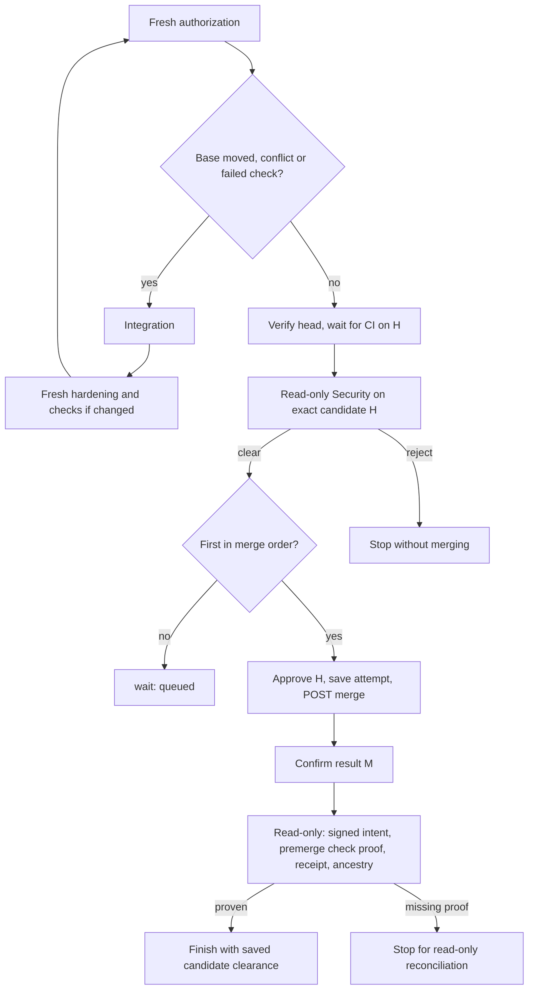

# Merge

This page describes the `merge` stage: what it may merge, merge order, the merge call, confirming the result, and completion. Synchronization with the base is in [sync](sync.md). The rules are in [delivery decisions](../decisions/delivery.md).

## What may merge

The merge stage merges only the revision its authorization names: the exact hardened, checked and Security-cleared code/input revision. It reads that authorization fresh before every mutation.

- A trusted-input change sends authored work back to Author and direct work back to Developer. Direct work needs no Gherkin or substitute requirements document.
- Any changed code head, including the Reviewer's own integration, goes back to `review` for hardening.
- A base that moved, a conflict or a failed check gets the Reviewer's integration (see [sync](sync.md)).

## Merge order

Merge order keeps slow issues from losing races repeatedly.

- With `--merge-queue N1,N2,…`, an issue ranked ahead that is at `review` or `merge` holds the slot, whatever its verdict.
- Without a queue, the merge stage applies no order. The `merge` op also accepts `mergeOrder: true`, under which an older PR at the `merge` stage whose lease hasn't expired holds the slot; the merge stage doesn't set it today.
- A held issue gets `{"merged": false, "reason": "queued", "waitingFor": N, "waitingForPr": PR}` and the job ends with `wait`.

The queue orders configured target mutations, not candidate-local integration, checks or read-only Security. It is not permission to run merges concurrently. The caller still runs one merge turn at a time.

## The merge call

1. Security clears the exact hardened and checked candidate at the observed target revision. A rejection, stale or missing clearance prevents approval and merge. The review/merge account submits a GitHub `APPROVE` review of the exact head H. A failed or mismatched approval prevents the merge.
2. A `mergeAttempt` checkpoint is saved and reread. It binds the repository, PR, literal base, source branch and the authorization. From then on, no automatic code write or repeat merge is allowed, even if the call is never sent.
3. The job calls `POST /repos/{owner}/{repo}/merges` with the configured repository, literal `baseBranch` and the full SHA H. The PR's own target and branch never choose the write. There's no fallback PR merge, push or admin bypass.
4. Only an HTTP 201 with a full result SHA M is saved as a possible own merge. HTTP 204 means already merged and is not an own receipt. A failed, lost or malformed response is never retried.

The base may differ from the repository's default branch. Merging to a configured base isn't permission to deploy anywhere.

## Confirm the result

After a 201, read-only reconciliation confirms that M is the PR's genuine merge: the same PR reads MERGED at exactly M, M has two parents `[P, H]`, and M is in the fetched base. Only then is the own-merge receipt saved.

- Confirmation retries on a schedule set by `mergeConfirmation`: `deadlineSeconds` (default 90, 1–600) and `backoffSeconds` (default `[1, 2, 4, 8, 10]`, at most 20 waits of 1–60 seconds, the last one repeating).
- The first check is immediate. No new check starts after the deadline.
- Waiting writes only evidence checkpoints, never code, another approval or a second merge.
- At the deadline, the issue stops: code may already have landed, and no further merge or code writer is authorized.

A PR merged outside the confirmed operation, for example by hand, isn't an own merge. A fresh claim stops it with merged truth retained for read-only reconciliation: no post-merge checks, hardening, writer or Security run.

## After the merge

Checks and Security clear the exact candidate before the target moves; nothing runs them on M (#185). After the merge, the read-only `confirm-merged` op confirms that the signed fast-forward intent and its receipt bind M to that candidate, that deterministic verification passed on exactly that commit before the merge, and that the same PR reads MERGED at M with M in the fetched base. It runs no checks. New own merges, interrupted ones and finished replays all take this path, and reuse their saved premerge [Security clearance](review.md#security-review) without another model pass.

Missing proof stops with merged truth retained, for read-only reconciliation: legacy two-parent or REST receipts, external or manual merges, and runs without exact premerge Security clearance. No post-merge suite, writer or Security review runs, and no proof is invented. A missing or mismatched candidate receipt cannot be repaired by pretending a postmerge review was premerge permission.

Only Security clearance bound to the genuine own merge's exact authorized candidate, or an exact saved result observation, allows completion. The `finish` op acts on the saved done state; it merges and publishes nothing itself. It:

- deletes the issue branch;
- sets `agent:merged` and removes `agent:working` on the PR and the issue;
- closes the issue's claims;
- closes the issue with a comment, which matters when the base isn't the default branch and GitHub doesn't auto-close it;
- removes the job's worktree.

A parent issue closes once all its sub-issues are closed and at least one merged. A finished issue whose `finish` didn't complete only runs `finish` again, once Security has cleared exactly what merged.

### Closed issues with an incomplete merge

A claim normally needs an open issue. A closed issue may resume only when genuine saved state shows an incomplete merge and its PR is freshly confirmed merged into the configured base. The winning claimant reopens the issue with the review/merge account. This covers GitHub auto-closing an issue before confirmation and completion; it isn't a general closed-issue retry.

## Recover after a confirmation deadline

1. Stop dispatching the issue.
2. Keep the state comment, local recovery files, the original hardening and integration, the attempt, any saved response M, merged facts and Security receipts.
3. Diagnose the metadata or network problem with reads only.
4. With the same issue, branch, lane, base, authorization and trusted inputs, lift the stop and run `merge` once. That run reads the saved attempt and response without approving or merging again, and gets its own confirmation window.
5. If identity or authorization changed, or evidence is still missing at the deadline, stop for explicit reconciliation. Don't keep restarting.

Never resend an uncertain merge by hand, repeat the approval, reopen a code writer, reset attempt evidence, clear merged facts or erase a Security rejection. An OPEN PR isn't proof that the request never landed.
